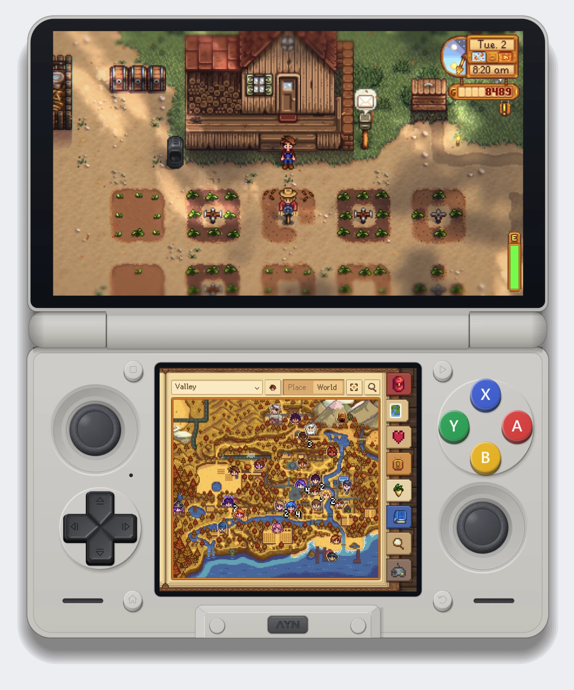
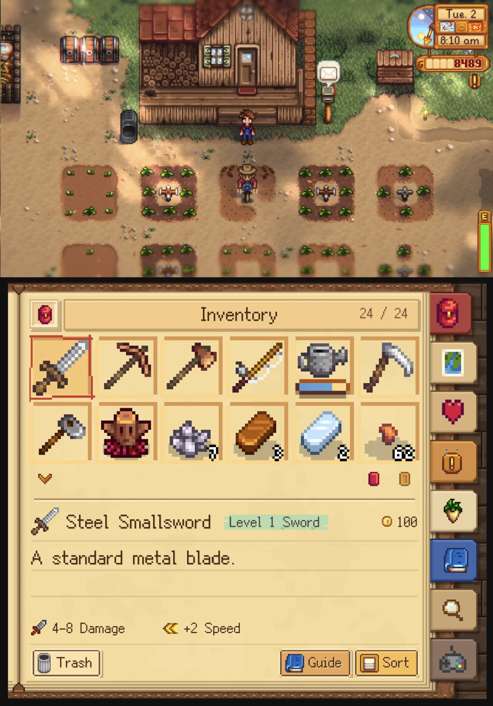
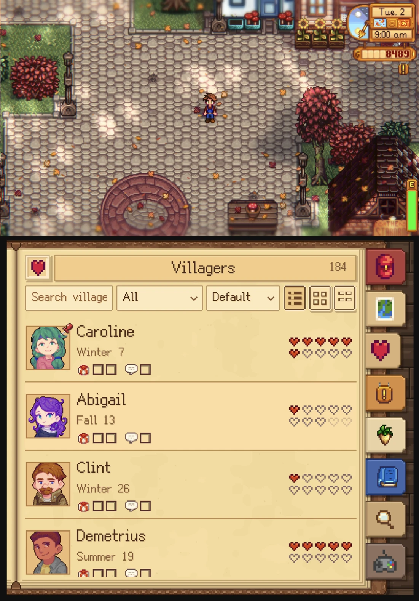
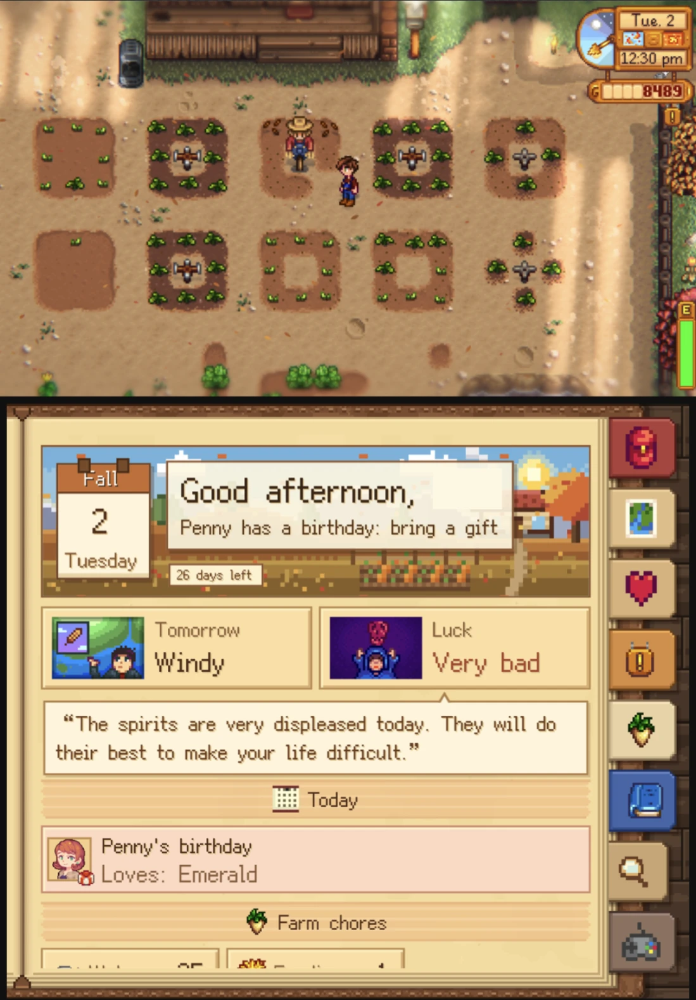
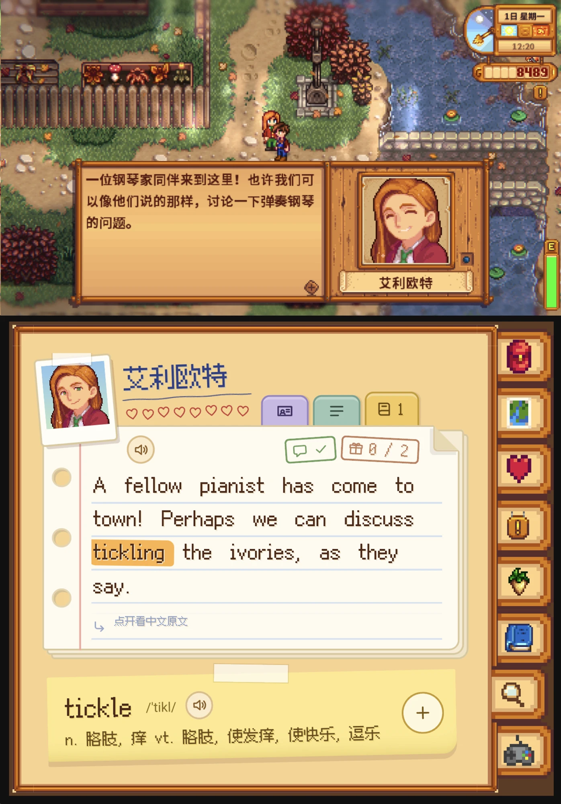
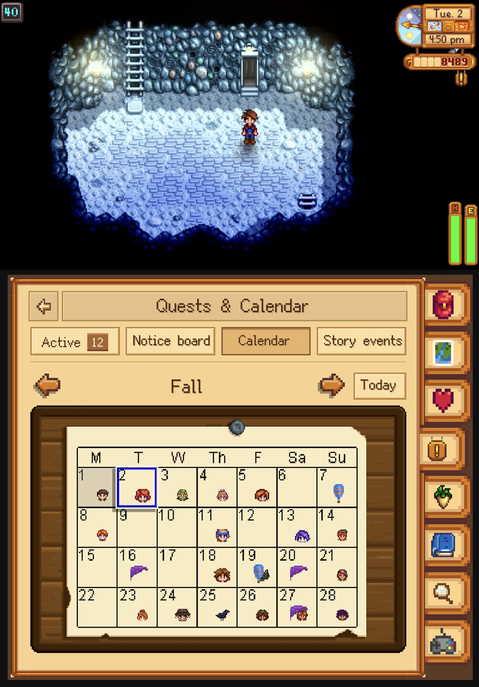
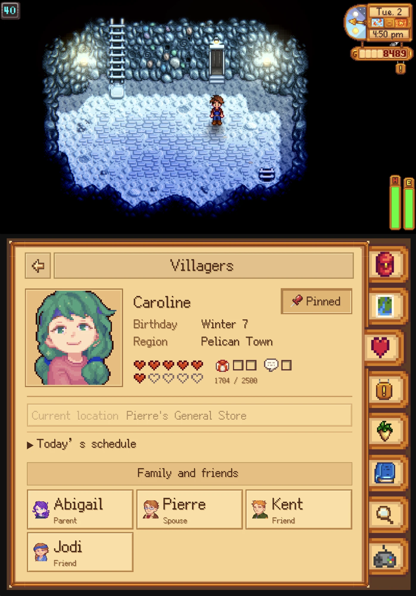

<h1 align="center">StardewDUO 双屏伴侣</h1>

<b>中文</b> · <a href="README.en.md">English</a>

  为 AYN Thor 做的非官方《星露谷物语》下屏伴侣：<b>上屏继续游戏，下屏随手翻看</b>背包、地图、居民、任务与日历、农务、手册和情境。

  

  <a href="docs/public/INSTALL.md">安装与配对</a> · <a href="docs/public/BUILD.md">构建</a> · <a href="docs/public/RELEASE.md">发布状态</a> · <a href="PRIVACY.md">隐私</a> · <a href="CONTRIBUTING.md">参与开发</a> · <a href="THIRD_PARTY_NOTICES.md">第三方许可</a>

## 看一看

<table>
  <tr>
    <td align="center" width="33%"> <b>背包</b> 原版布局，属性、售价与整理</td>
    <td align="center" width="33%"> <b>居民</b> 好感、生日、今日聊天与送礼</td>
    <td align="center" width="33%"> <b>早晨简报</b> 明日天气、今日运势、生日与待办</td>
  </tr>
  <tr>
    <td align="center"> <b>对话</b> 看英文原句、点词查义、朗读</td>
    <td align="center"> <b>任务与日历</b> 本季生日、节日、告示与任务</td>
    <td align="center"> <b>居民档案</b> 当前位置、今日行程、家人朋友</td>
  </tr>
</table>

截图来自开发中的版本（App 0.11.1-dev.62 至 dev.74；上排为新的手账风格，下排为原版菜单风格）。手账风格和对话页尚未包含在当前公开源码（App 0.11.1-dev.55）中。截图中的游戏画面版权归 ConcernedApe 所有。

## 能做什么

- **背包**：原版布局、品质与属性、数量步进、整理及经过游戏回执确认的物品操作。
- **地图与居民**：世界/局部地图、居民定位、送礼聊天状态、档案、行程和礼物资料。
- **任务与农务**：告示接取、奖励领取、已完成记录、生日节日、待办、收获日历、作物利润计算。
- **手册与角色**：物品收藏、制作、装备、原版及模组技能、图鉴、剧情事件、社区中心收集包与 Wiki 阅读器。
- **模组适配**：运行时物品与居民目录、已知信息隐藏、家庭与居民关系、农务扩展，以及模组清单和上屏 GMCM 设置入口。各项适配按版本限定，无法读取时明确提示。
- **情境**：当前对象、箱子整组搬运、商店、钓鱼、矿层、夜晚结算和早晨简报；自动切换可逐项设置。

## 需要什么

- 自己的 PC 版《星露谷物语》，在 Thor 上通过 Cinderbox 与 SMAPI 运行；原版 Android 手游不是目标。
- 下屏 App 与配套 SMAPI 模组，安装与配对步骤见 [安装与配对](docs/public/INSTALL.md)。
- 公开 APK 不内置游戏原版美术、音效和离线文字：用户从自己的游戏生成并导入私有素材 ZIP。
- 未配对也可以查看；背包、制作、奖励和箱子操作需要本机密钥配对。多人游戏中的写入不受支持。没有保存、读档或任意脚本执行端点。

本项目与 ConcernedApe、Nintendo、AYN 均无关联。

## 版本状态

当前源码是 App 0.11.1-dev.55、模组 0.10.1-dev.42，尚未作为这组版本公开发行。历史 beta.1 测试包已在一台 AYN Thor 上完成安装、首次素材导入、配对和短时实机检查（[记录](docs/public/THOR-BETA1-20260927.md)）；这些结果不代表当前源码的实机验收。60 分钟以上实际游玩和实际存档上的写入功能仍未验收。主机模拟、协议检查与隔离 PC 游戏验证的范围见 [发布状态](docs/public/RELEASE.md)。

应用 ID 为 `io.github.chankamman_dev.stardewds`（开发构建 `….dev`），模组 ID 为 `chankamman.StardewDS`。从 beta.1 升级时新 App 会作为另一个应用安装，需要重新导入素材和配对；模组文件夹名仍为 `StardewThor.ReadOnly`，覆盖三个文件即可，配对密钥与已完成任务记录会保留。

## 开发

Node.js 24、.NET SDK 8、JDK 17、PowerShell 7，Android 构建需要 SDK 35。

~~~powershell
npm ci
npm run test:public
~~~

这是不依赖游戏素材的自包含测试。游戏相关构建与素材生成的参数见 [构建](docs/public/BUILD.md) / [安装](docs/public/INSTALL.md) 文档。发布源码采用 MIT；Fusion Pixel Font 保持 OFL 1.1。游戏本身与其素材不受 MIT 覆盖。

本地内部仓库保留开发历史与 HANDOFF；公开源码由白名单导出，必须使用干净目录初始化公开 Git，不能直接推送内部历史。[GitHub 上传说明](docs/public/GITHUB.md)
